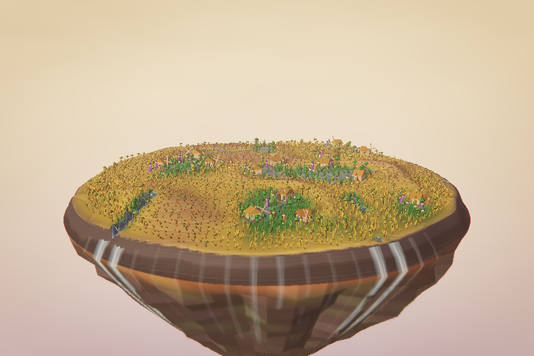
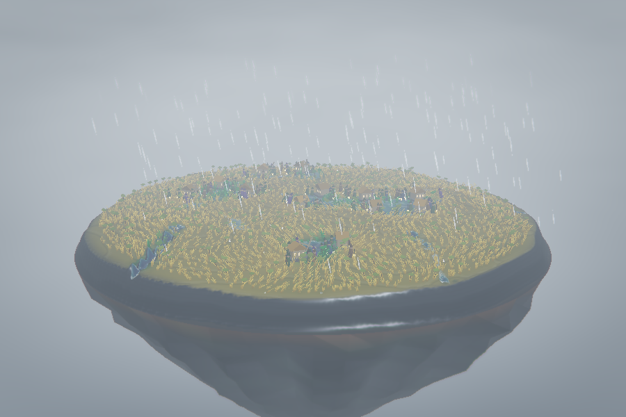
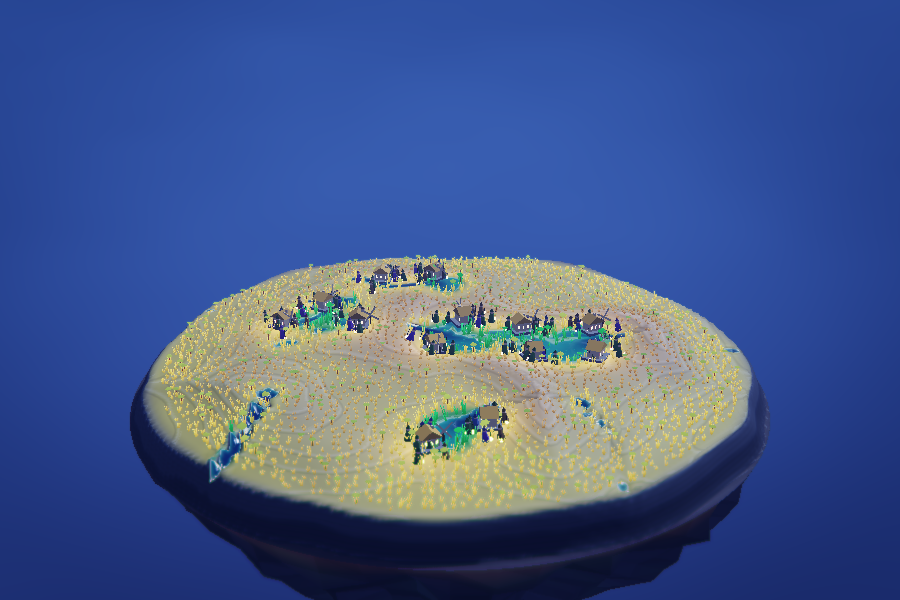
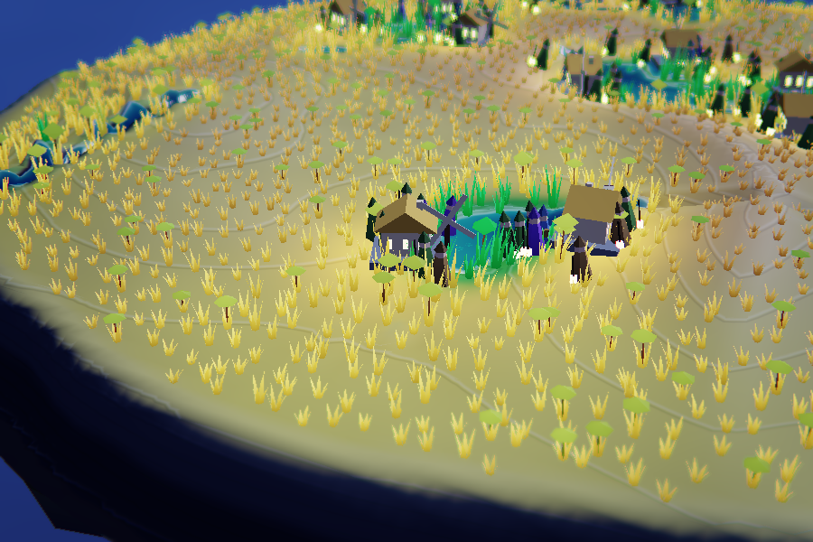

# Living Mythos

A tactile tilt-shift floating island: shallow-water hydrology, soil and crop succession, 120 autonomous villagers,
Masons who build what the land demands, myths that become carved stones and music — all in one self-contained
`dist/index.html` (Three.js r186 from jsDelivr, no other assets).

## Run it
```
cd dist && python3 -m http.server 8000      # then open http://localhost:8000 in the phone browser
```
(Opening `dist/index.html` directly also works in most desktop browsers; it needs internet for the three.js CDN.)

## Play
| | Mouse | Touch |
|---|---|---|
| Use the selected tool | left hold on the island | tap (pulse) |
| Alternate action (carve) | right button or Shift | long-press (hold 0.4 s) |
| Orbit / pan / zoom | drag off the island, right-drag, wheel | drag, two-finger drag, pinch |
Tools: 1 Sculpt Land · 2 Summon Raincloud · 3 Drop Monolith · 4 Shepherd Breeze. Atmosphere: Q Golden Hour · W Aurora ·
E Monsoon · D let it drift. M sound · P photo mode (saves a PNG). The island autosaves; `?fresh=1` starts over.
URL options: `?seed=N` `?q=low|mid|high` `?atmo=0..1` `?debug=1` (developer overlay + test hooks).

## Screens (rendered headlessly on Mesa llvmpipe)




On the phone (Pixel, portrait, its own GPU): `docs/screens/phone-portrait.png`.
Waterfall and island: `docs/screens/waterfall.png`, `island-topdown.png`.
Tool shots: `docs/screens/tool-sculpt.png`, `tool-raincloud.png`, `tool-monolith.png`, `tool-breeze.png`.

## Build & verify (no GPU needed for most of it)
```
npm run build      # src/ -> dist/index.html (dependency-free bundler, tools/build.mjs)
npm test           # sim, geometry, audio (fake AudioContext), persistence, quality-governor tests
npm run check      # build + static audit of the spec contract + headless shader-compile smoke test
npm run interact   # real mouse/touch/keyboard in headless Chrome against the built app
npm run heap       # frame-loop allocation check in the real app
npm run verify     # everything above (+ `npm run audio`: offline render of the audio engine, measured for clipping/loudness)
node tools/preview-map.mjs out.ppm 240   # top-down picture of the simulation after 240 sim seconds
node tools/snap.mjs out.png --query atmo=0.5   # render a real frame (software GL) — see NOTES.md
node tools/shoot-tools.mjs dir           # drive the four tools with the mouse and save frames
node tools/phone-server.mjs 8765 /tmp/phone   # then termux-open-url 'http://localhost:8765/?report=x&debug=1' — run it on the phone itself and read fps/GPU/errors/snapshot back
```
See NOTES.md for architecture notes, tuning history and the one big caveat (visuals not yet seen by a human).
